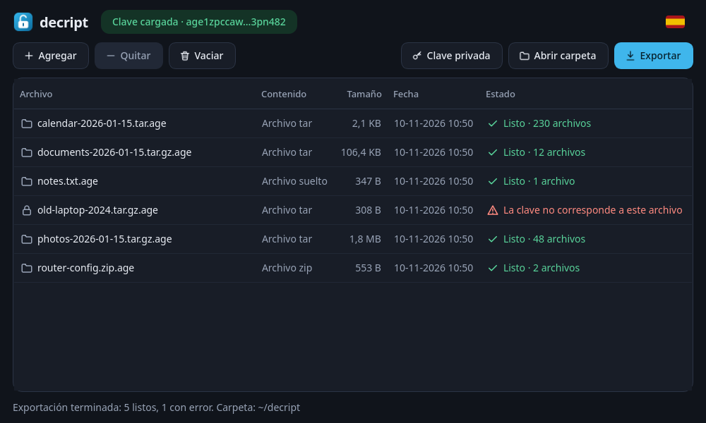
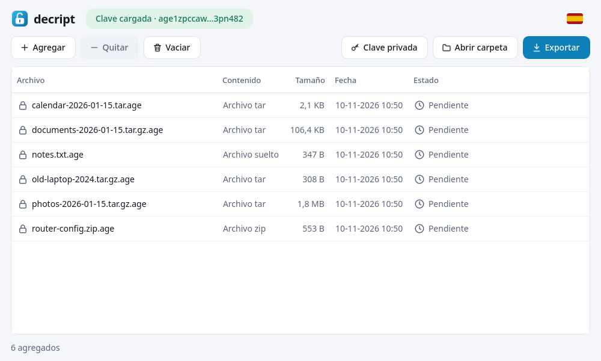
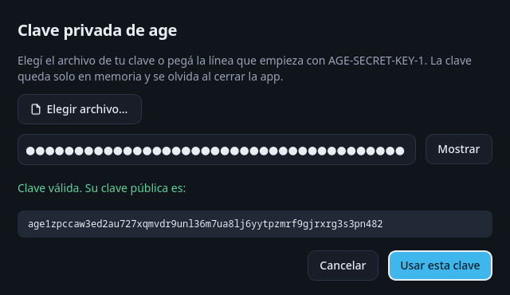

<p align="center"></p>

<h1 align="center">decript</h1>

<p align="center">Descifrá y extraé copias de seguridad cifradas con <a href="https://age-encryption.org">age</a> en pocos clics.<br>
<a href="README.md">Read in English</a></p>



decript es una app de escritorio chica para Linux. Agregás tus archivos `.age`, cargás tu clave privada, tocás **Exportar**, y cada copia queda descifrada y extraída en su propia carpeta dentro de `~/decript`.

Está pensada para restaurar copias hechas con `tar … | age -r <clave pública>`, pero sirve para cualquier archivo cifrado con una clave X25519 de age.

## Qué hace

- **Agregar archivos** con el botón, o arrastrando archivos y carpetas a la ventana.
- **Clave privada** desde un archivo o pegada como texto. Queda solo en memoria y se olvida al cerrar la app.
- **Una carpeta por copia**: `fotos-2026-01-15.tar.gz.age` se exporta a `~/decript/fotos-2026-01-15/`.
- **Extrae** `.tar`, `.tar.gz`, `.tar.xz`, `.tar.bz2` y `.zip`. Cualquier otro archivo se descifra y queda como está.
- **Nunca pisa nada**: si la carpeta existe, crea `nombre-2`, `nombre-3`, etc.
- **Errores claros por archivo**, como "La clave no corresponde a este archivo", sin frenar el resto.
- Tema **claro y oscuro** según el sistema, en **español e inglés**.
- **Sin red, sin telemetría y sin guardar nada**: ni configuración, ni historial, ni la clave en disco.

| Tema claro | Diálogo de clave privada |
|---|---|
|  |  |

## Instalación

Bajá `decript-<versión>-x86_64.AppImage` de la [página de versiones](../../releases) y después:

```sh
chmod +x decript-*-x86_64.AppImage
./decript-*-x86_64.AppImage
```

No hay que instalar nada más: Python, Qt y la biblioteca de age van dentro del AppImage.

## Uso

1. **Agregá** tus archivos `.age` (o soltalos sobre la ventana).
2. Tocá **Clave privada** y elegí el archivo de tu clave, o pegá la línea que empieza con `AGE-SECRET-KEY-1`.
3. Tocá **Exportar**. El resultado queda en `~/decript`; con doble clic en una fila terminada se abre su carpeta.

Atajos: `Ctrl+O` agregar, `Ctrl+K` clave privada, `Ctrl+E` exportar, `Supr` quitar de la lista.

También podés pasar archivos por línea de comandos: `./decript-*.AppImage copia.tar.gz.age`.

## Seguridad

- La clave privada solo está en memoria. decript nunca la escribe en disco, en un registro ni en el portapapeles.
- Las carpetas exportadas se crean con permisos `700` y los archivos con `600`.
- La extracción es segura: se rechazan las entradas con rutas absolutas, con `..` o con enlaces que apuntan fuera de la carpeta.
- El descifrado lo hace [pyrage](https://github.com/woodruffw/pyrage), la interfaz de Python para [rage](https://github.com/str4d/rage), la implementación de age en Rust.
- decript no hace ninguna conexión de red.

Las copias descifradas son archivos comunes: borrá `~/decript` cuando ya no las necesites.

## Todavía no soporta

- Archivos cifrados con contraseña (`age -p`).
- Claves protegidas con contraseña, claves SSH y plugins de age (como YubiKey).

## Compilar desde el código

Requisitos: [uv](https://docs.astral.sh/uv/) y [appimagetool](https://github.com/AppImage/appimagetool/releases).

```sh
git clone https://github.com/mrsalvaa/decript.git
cd decript
uv venv --python 3.13 .venv
uv pip install --python .venv/bin/python pyrage PySide6-Essentials pytest

# Ejecutar desde el código
PYTHONPATH=src .venv/bin/python -m decript

# Tests
.venv/bin/python -m pytest

# Construir el AppImage (appimagetool en el PATH, o su AppImage en build/)
./packaging/build-appimage.sh
```

Las capturas se generan con datos inventados mediante `tools/screenshots.py`.

## Licencia

[GPL-3.0-or-later](LICENSE). decript incluye PySide6/Qt (LGPL-3.0) y pyrage (MIT).
