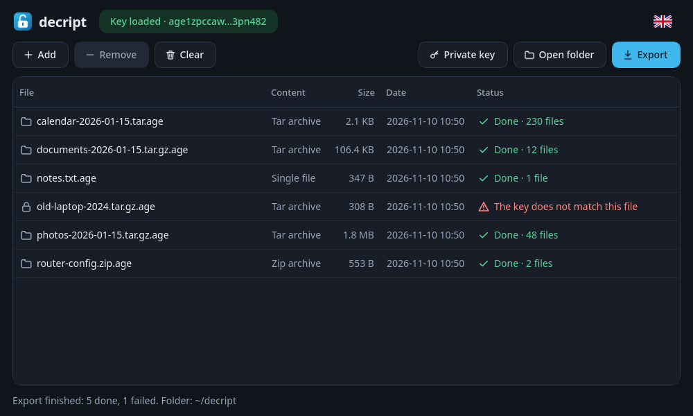
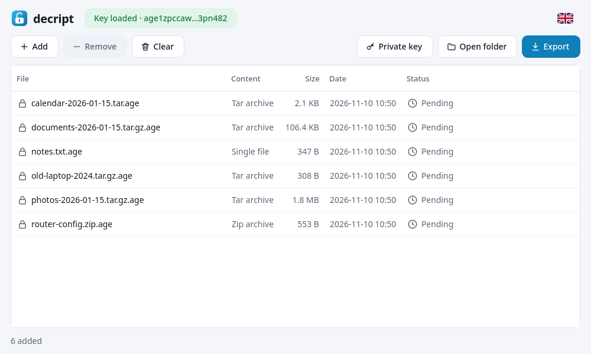
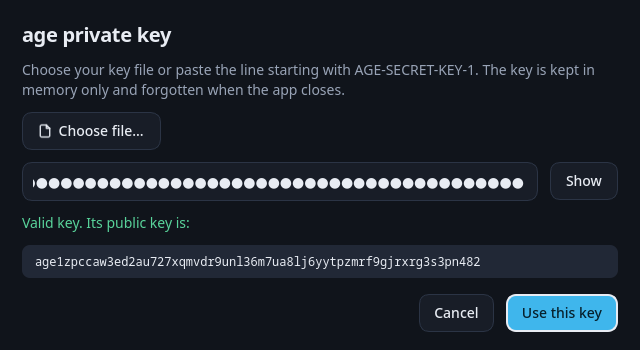

<p align="center"></p>

<h1 align="center">decript</h1>

<p align="center">Decrypt and unpack <a href="https://age-encryption.org">age</a>-encrypted backups with a few clicks.<br>
<a href="README.es.md">Leer en español</a></p>



decript is a small desktop app for Linux. Add your `.age` files, load your private key, press **Export**, and each backup is decrypted and unpacked into its own folder in `~/decript`.

It was made for restoring backups created with `tar … | age -r <public key>`, but it works with any file encrypted to an age X25519 key.

## Features

- **Add files** with the button, or drag and drop files and folders onto the window.
- **Private key** from a file or pasted as text. It is kept in memory only and forgotten when the app closes.
- **One folder per backup**: `photos-2026-01-15.tar.gz.age` is exported to `~/decript/photos-2026-01-15/`.
- **Unpacks** `.tar`, `.tar.gz`, `.tar.xz`, `.tar.bz2` and `.zip`. Any other file is decrypted and left as it is.
- **Never overwrites**: if the folder exists, it creates `name-2`, `name-3`, and so on.
- **Clear errors per file**, such as "The key does not match this file", without stopping the rest.
- **Light and dark** themes following the system, in **English and Spanish**.
- **No network access, no telemetry, nothing saved**: no settings file, no history, no key on disk.

| Light theme | Private key dialog |
|---|---|
|  |  |

## Install

Download `decript-<version>-x86_64.AppImage` from the [releases page](../../releases), then:

```sh
chmod +x decript-*-x86_64.AppImage
./decript-*-x86_64.AppImage
```

It needs no installation and no other packages: Python, Qt and the age library are inside the AppImage.

## Usage

1. **Add** your `.age` files (or drop them on the window).
2. Press **Private key** and choose your key file, or paste the line that starts with `AGE-SECRET-KEY-1`.
3. Press **Export**. The result is in `~/decript`; double-click a finished row to open its folder.

Shortcuts: `Ctrl+O` add, `Ctrl+K` private key, `Ctrl+E` export, `Del` remove from the list.

You can also pass files on the command line: `./decript-*.AppImage backup.tar.gz.age`.

## Security

- The private key is only held in memory. decript never writes it to disk, to a log or to the clipboard.
- Exported folders are created with permissions `700` and files with `600`.
- Archives are unpacked safely: entries with absolute paths, `..`, or links pointing outside the folder are rejected.
- Decryption is done by [pyrage](https://github.com/woodruffw/pyrage), the Python bindings for [rage](https://github.com/str4d/rage), the Rust implementation of age.
- decript makes no network connections.

Decrypted backups are plain files: delete `~/decript` when you no longer need them.

## Not supported yet

- Files encrypted with a passphrase (`age -p`).
- Passphrase-protected key files, SSH keys and age plugins (such as YubiKey).

## Build from source

Requirements: [uv](https://docs.astral.sh/uv/) and [appimagetool](https://github.com/AppImage/appimagetool/releases).

```sh
git clone https://github.com/mrsalvaa/decript.git
cd decript
uv venv --python 3.13 .venv
uv pip install --python .venv/bin/python pyrage PySide6-Essentials pytest

# Run from source
PYTHONPATH=src .venv/bin/python -m decript

# Tests
.venv/bin/python -m pytest

# Build the AppImage (appimagetool in PATH, or its AppImage in build/)
./packaging/build-appimage.sh
```

The screenshots are generated from made-up data with `tools/screenshots.py`.

## License

[GPL-3.0-or-later](LICENSE). decript bundles PySide6/Qt (LGPL-3.0) and pyrage (MIT).
